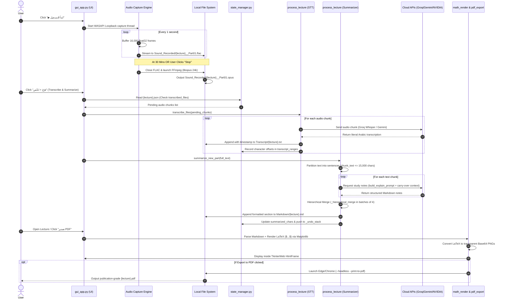

<div align="center">


# StudyNotes — Automatic Lecture Recording, Transcription & Summarization

**A lightweight Windows desktop app that records system audio (online lectures, meetings, Zoom, Teams), transcribes speech with Whisper & Gemini, and generates structured, lecturer-style Markdown notes with rendered math equations — all with zero manual effort.**

[](../../releases/latest)
[](https://www.python.org/)
[](https://docs.python.org/3/library/tkinter.html)
[](https://ai.google.dev/)
[](https://groq.com/)
[](https://www.nvidia.com/)

</div>

---

## What does this project do?

- **Zero-loss system audio recording:** Records internal system audio while a lecture or meeting is playing — automatically partitioned every 30 minutes to prevent oversized files and corrupted streams.
- **Background Opus compression:** Every finished chunk is immediately compressed to high-efficiency **Opus** via `ffmpeg` in the background, saving disk space with zero downtime or recording pauses.
- **Multi-provider AI transcription:** One-click transcription leveraging **Groq Whisper** (`whisper-large-v3`) as the ultra-fast primary engine, with **Google Gemini** as an automatic fallback.
- **Subject-aware AI notes:** Transcripts are transformed into structured, lecturer-style Markdown notes tailored to specific domains (Computer Science, Engineering, Medicine, Law, Business, Languages, Math/Science, Humanities).
- **Hierarchical consolidation:** Long lectures are processed chunk-by-chunk and merged hierarchically in small batches using dedicated consolidation prompts, eliminating the "Lost in the Middle" context degradation problem.
- **In-app math rendering:** LaTeX equations (`$...$` and `$$...$$`) are parsed and rendered directly inside the built-in HTML viewer using headless matplotlib mathtext.
- **Headless PDF export:** Exports notes to publication-ready PDFs (featuring right-to-left Arabic formatting, Pygments syntax highlighting, callout boxes, and equations) using the user's existing local browser (Edge or Chrome) without heavy third-party PDF dependencies.
- **Cloud-managed dynamic AI routing:** Model priority orders, circuit breaker parameters, and fallbacks are fetched dynamically from `model_config.json` without requiring app updates.
- **Full state tracking & undo:** Audio parts, transcripts, and notes are tracked per-lecture with status badges (`متسجل بس`, `متفرغ`, `متفرغ ومتشرّح`) and multi-level undo support.

---

## Features

| Feature | Detail |
|---|---|
| 🎙️ **System Audio Recording** | Native WASAPI Loopback capture with automatic 30-minute chunking, pause/resume, and live title bar status |
| 🗜️ **Automatic Compression** | Asynchronous background FLAC $\to$ Opus transcoding (24 kbps) with zero capture interruptions |
| 📝 **Multi-Provider STT** | Groq (`whisper-large-v3` / `turbo`) as primary, falling back to Google Gemini File API |
| 🧠 **Subject-Aware Summarization** | 8 tailored subject profiles (CS, Engineering, Medicine, Law, Business, Languages, Science, Humanities) |
| 🔀 **Hierarchical Merging** | Partial chunk notes are consolidated in batches of 4, preserving granular detail across multi-hour sessions |
| 📄 **Native PDF Export** | One-click headless browser PDF generation with full RTL Arabic, Monokai code highlighting, and vector math |
| 🌐 **Remote Model Config** | Dynamic model ordering and circuit breaker tuning fetched via GitHub with local cache and hardcoded safety nets |
| 🛡️ **Circuit Breaker & Backoff** | Exponential backoff, OTPM token limit detection, and automatic model failover |
| ➗ **LaTeX Math Rendering** | Converts inline and display LaTeX equations into transparent Base64 PNGs |
| 🗂️ **State Management & Undo** | Tracks audio-to-text byte ranges per chunk, supporting multi-step notes rollback |
| 🧹 **Selective Cleanup** | Granular deletion of audio, raw transcripts, or notes with confirmation guards |
| 📦 **Windows Installer** | Packaged as a clean, portable installer via PyInstaller and Inno Setup |

---

## System Architecture

<div align="center">

### End-to-End Processing Pipeline


<br/>

### High-Level Component Architecture


</div>

---

### End-to-End Data Flow Sequence

The complete lifecycle of a lecture—from live system sound to rendered study notes—follows this continuous pipeline:



---

### Core Subsystem Architecture & Engineering Highlights

#### 1. Audio Ingestion & Asynchronous Compression (`record_session.py` & `gui_app.py`)
- **Native WASAPI Loopback:** Directly samples Windows audio endpoints without physical or virtual microphones (16,000 Hz, 1 channel, 32-bit float).
- **Zero-Downtime Chunking:** Automatically partitions active recordings every **30 minutes** (`CHUNK_MINUTES = 30`), ensuring multi-hour sessions remain memory-safe and recoverable against crashes.
- **Background Opus Transcoding:** Launches detached FFmpeg workers converting uncompressed FLAC to ultra-compact Opus (`libopus`, 24 kbps, 16 kHz), achieving **~85% file size reduction** without interrupting ongoing capture.

#### 2. Atomic State Management & Storage Engine (`state_manager.py`)
- **Power-Loss Resilient Atomic Writes:** State files are written to `.json.tmp`, flushed, synchronized via `os.fsync()`, and atomically swapped via `os.replace()`, preventing half-written corrupted states during sudden power loss.
- **Granular Character Range Offsets:** Maps each audio chunk to exact character boundaries within the master transcript (`transcript_ranges: {"Part 01.opus": [start, end]}`), enabling surgical single-part deletions.
- **Multi-Level State Rollback:** Maintains an in-session `_undo_stack` allowing users to revert the latest summarization operation without touching underlying audio or transcripts.

#### 3. Dynamic Remote Routing & Circuit Breaker (`remote_config.py`)
- **3-Tier Configuration Hierarchy:** Model chains, active priorities, and tuning limits are loaded through a robust fallback chain:
  $$\text{Remote JSON (GitHub HTTPS)} \longrightarrow \text{Local Cache (.state/)} \longrightarrow \text{Hardcoded Fallbacks}$$
- **Self-Healing Circuit Breaker:** Monitors consecutive provider failures; upon 2 consecutive failures, trips the model into an exponential cooldown (`90s` up to `600s`) before testing recovery.
- **Structural OTPM Detection:** Identifies unrecoverable Output Tokens Per Minute exhaustion (e.g. Qwen 27B payload limits) and skips futile retries to immediately route to higher-capacity fallback models.

#### 4. Domain Prompt Engine & Hierarchical Consolidation (`prompts.py` & `process_lecture.py`)
- **8 Specialized Subject Profiles:** Dynamically tailors summarization rules for Computer Science, Engineering, Medicine, Law, Business, Languages, Mathematics/Science, and Humanities.
- **Context Carry-Over:** Injects the trailing ~220 characters of prior chunk summaries into subsequent chunk prompts, eliminating redundant definitions and ensuring thematic continuity.
- **Hierarchical Batch Merging:** Consolidates partial summaries in batches of 4 (`MERGE_BATCH_SIZE = 4`) using dedicated consolidation prompts (`CONSOLIDATION_PROMPT`), overcoming LLM "Lost in the Middle" attention degradation.

#### 5. Headless LaTeX Rendering & PDF Export (`math_render.py` & `pdf_export.py`)
- **Transparent Math PNG Synthesis:** Parses inline (`$...$`) and display (`$$...$$`) LaTeX equations, converting them into transparent Base64 PNGs via headless `matplotlib.pyplot` in `Agg` mode.
- **Browser-Powered Headless PDF Export:** Discovers native Microsoft Edge or Google Chrome binaries, executing a detached print process (`--headless=new --print-to-pdf`) with full right-to-left Arabic layout, Monokai syntax highlighting, and callout boxes.

---

### Concurrency & Threading Model

StudyNotes coordinates background tasks through dedicated daemon threads to prevent any UI freezing on the main Tkinter thread:

| Thread Worker | Target Function | Lifecycle | Communication Mechanism |
| :--- | :--- | :--- | :--- |
| **Main GUI Thread** | `StudyApp.mainloop` | App Lifetime | Native Tkinter Event Loop & Dispatcher |
| **Capture Worker** | `_capture_loop` | Active Recording | Streams audio frames into thread-safe `audio_queue` |
| **Chunk Writer** | `_write_loop` | Active Recording | Consumes `audio_queue` and writes FLAC to disk |
| **FFmpeg Transcoder** | `_compress_chunk_background` | Per 30-min chunk / on stop | Spawns FFmpeg CLI, dispatches completion via `root.after` |
| **AI Processor** | `_process_worker` | Transcription / Summarization | Executes network STT & LLM calls, streams logs via `root.after` |
| **PDF Exporter** | `_export_pdf.worker` | PDF Generation | Runs headless browser subprocess, alerts UI on completion |
| **Config Refresher** | `remote_config.refresh` | App launch & settings changes | Fetches remote models asynchronously without blocking UI |

---

## Releases & Changelog

Newest first. Releases with pre-built binaries are available on the [Releases](../../releases) page.

### v1.8.1 — 2026-11-03

#### Fixed
- **Domain Extra Toggles Now Active:** Fixed a disconnect where selected subject options (`lecture_extra1/2/3`) — such as exact code extraction, interview question spotting, full mathematical derivations, clinical differential diagnosis, and legal exceptions — were saved in settings but never passed to the AI summarization prompt.
- **Factual Correction Mode Default:** Resolved a configuration mismatch where factual error corrections (`🔧`) were turned off by default despite release specifications, ensuring it is now properly enabled out of the box.
- **Atomic State Persistence:** Implemented safe atomic writes (`.json.tmp` + `os.fsync` + `os.replace`) and corrupted JSON recovery in `state_manager.py` to prevent session loss or app crashes during sudden system power downs.
- **Gemini Cloud Storage Leak:** Added guaranteed file cleanup (`client.files.delete`) in a `finally` block after Gemini audio transcription, preventing account-level 20GB quota exhaustion over time.
- **Oversized Unpunctuated Chunking:** Transcripts of rapid or continuous speech without punctuation marks are now dynamically partitioned (`_split_oversized_sentence`) at whitespace boundaries before reaching payload limits.

---

### v1.8.0 — 2026-11-02

#### New
- **Subject-Tailored Notes:** Added 8 specialized academic subject profiles (Programming/CS, Engineering, Medicine, Law, Business, Languages, Math/Science, Humanities & History) adapting terminology, structure, and formatting.
- **Domain Extra Toggles:** Configurable per-subject extraction options (e.g., exact code blocks, interview questions, clinical red-flag warnings, legal exceptions, derivation steps).
- **Automatic Lecture Recap:** Appends a consolidated end-of-lecture executive recap once all segments are summarized.
- **Remote Model Configuration (`remote_config.py`):** Model chains and fallback priorities can now be updated remotely via `model_config.json` on GitHub without re-releasing the application.
- **Dynamic Model Settings Dialog:** Visualized fallback chains using color-coded, numbered pill chips with instant status updates.
- **Subject-Aware Meeting Consolidation:** Applied subject-aware heuristics to meeting minutes and action-item merges.

#### Improved
- **Fast Failover on Structural OTPM:** Recognizes Output Tokens Per Minute exhaustion (e.g. Qwen 27B on Groq) and advances immediately to higher-capacity models without wasting time on futile retries.
- **Smart Manual Selection Routing:** If a manually chosen model fails, the system tries other models from the same provider first before jumping to a different vendor.
- **Responsive Cancellation:** Job cancellation (`threading.Event`) halts processing immediately at any sub-stage and checkpoints finished work instead of discarding it.
- **Model Roster Update:** Deprecated retired models and introduced newer Gemini 3.8/3.7 and Groq configurations.

#### Fixed
- App crashing on session creation due to invalid color palette lookup.
- UI dialog layout defects: off-center meeting cards, shrinking buttons under custom subjects, and clipped action buttons.
- Emoji rendering fallback issues on older Windows font configurations.
- Bidirectional text scrambling when mixing Arabic and English titles in dialog headers.
- Orphaned lecture entries remaining visible in lists after manual file deletions.
- Progress bar displaying confusing `0` values after skipping previously transcribed parts.
- Audio segment indexing collisions when re-recording after deleting previous audio files.
- Memory and storage quota build-up on cloud provider accounts during long-running sessions.

---

### v1.7.0 — 2026-10-08

- Fixed audio chunks occasionally yielding shorter durations after Opus compression.
- Eliminated black console windows flashing during background FFmpeg transcoding.
- Simplified update installation flow by launching Inno Setup with direct user prompts.
- Resolved launcher startup failures on non-standard Windows locales.

---

### v1.6.0 — 2026-09-29

- Fixed API keys failing to persist across application restarts.
- Resolved intermittent PDF export failures on clean Windows installations.
- Optimized bundle size by stripping unused binary dependencies from PyInstaller.
- Corrected application icon rendering in the Windows "Installed Apps" control panel.
- Enabled custom directory selection during the setup wizard.

---

### v1.5.0 — 2026-09-24

- **PDF Export Lock Fix:** Resolved `WinError 32` when cleaning up temporary browser profiles by implementing graceful retry loops while Chromium sub-processes release locks.

---

### v1.4.0 — 2026-09-24

- **In-App Feedback System:** Integrated modal rating window with offline JSON queueing (`evaluation.py`) powered by Supabase REST endpoints.
- **Hierarchical Consolidation:** Introduced small-batch merging (`MERGE_BATCH_SIZE = 4`) to prevent context loss during long 10+ chunk lectures.
- **Dedicated Consolidation Prompts:** Separated initial summarization prompts from consolidation logic into `prompts.py`.

---

### v1.3.0 — 2026-09-03

- **Subject-Aware Prompts:** Added preliminary domain selection for academic lectures.
- **NVIDIA NIM Integration:** Added NVIDIA Nemotron models as an optional third-tier summarization provider.
- **First-Run Wizard:** Interactive onboarding dialog with real-time API key verification.
- **Adaptive Chunk Splitting:** Oversized text blocks automatically bisect and retry upon provider payload rejection.

---

### v1.2.0 — 2026-08-28

- **Sequential Part Numbering:** Enforced `__Part 01`, `__Part 02` naming schema across session pauses.
- **Live Title Indicator:** Reflects active recording and pause status directly in the taskbar.
- **Markdown Fenced Blocks:** Guaranteed proper syntax fences for all technical code snippets.

---

### v1.1.0 — 2026-08-25

- Fixed mixed-language Arabic/English text reversing inside log widgets using Unicode Bidi Isolates.
- Added live pause/resume capability during recording sessions.
- Added disk space safety checks before initiating recording.

---

### v1.0.0 — 2026-08-23

- Initial release: WASAPI Loopback recording, Opus transcoding, Groq/Gemini transcription, Markdown generation, and LaTeX math rendering.

---

## Project Structure

```text
.
├── system/
│   ├── gui_app.py             # Main Tkinter GUI application & event controller
│   ├── process_lecture.py     # AI pipeline (STT, summarization, chunking, circuit breaker)
│   ├── remote_config.py       # Dynamic remote model config, local cache & fallback chains
│   ├── prompts.py             # Academic subject prompts, meeting profiles & consolidation prompts
│   ├── state_manager.py       # File hierarchy, lecture locks & state tracker (.state/*.json)
│   ├── math_render.py         # Matplotlib headless LaTeX ($...$) to Base64 PNG renderer
│   ├── pdf_export.py          # Headless Edge/Chrome PDF printer (RTL Arabic + CSS)
│   ├── record_session.py      # Standalone CLI WASAPI loopback audio recorder
│   ├── first_run_setup.py     # Onboarding setup wizard & API key validation dialogs
│   ├── updater.py             # Auto-update checker & installer launcher
│   ├── evaluation.py          # In-app user feedback dialog & Supabase offline queue
│   ├── manage_config.py       # Developer CLI tool for updating model_config.json
│   ├── manage_config_gui.py   # Developer GUI tool for managing model configs & Git push
│   └── feedback_setup.sql     # Supabase Row-Level Security setup script
├── tests/
│   ├── test_remote_config.py  # Unit tests for remote config fetch, caching & validation
│   ├── test_explain_flow.py   # End-to-end integration tests for model failover & circuit breaker
│   └── test_gui_catalog.py    # Unit tests for dynamic GUI dropdowns & legacy key resolution
├── model_config.json          # Master remote model priority & tuning configuration
├── requirements.txt           # Python dependency specifications
├── studynotes.spec            # PyInstaller onedir build configuration
├── studynotes.iss             # Inno Setup Windows installer compiler script
└── .env.example               # Template for API keys and directory configuration
```

> **Runtime Directories:** When running, StudyNotes automatically manages data inside `%LOCALAPPDATA%\StudyNotes\` (or next to the script in portable mode):
> - `Sound_Recorded/`: Stores `.flac` and compressed `.opus` audio segments.
> - `Transcript/`: Accumulative verbatim transcript backups (`.txt`).
> - `Markdown/`: Formatted lecture study notes (`.md`).
> - `.state/`: JSON session state, range offsets, and cached configurations.

---

## Requirements

- **Operating System:** Windows 10 or Windows 11 (64-bit recommended).
- **Python:** Version 3.11 or higher.
- **FFmpeg:** Optional but highly recommended. Enables background Opus compression. If omitted, recordings remain as uncompressed FLAC.
- **Web Browser:** Microsoft Edge (pre-installed on Windows 10/11) or Google Chrome (required only for PDF export).
- **API Keys (At least one required):**
  - [Google Gemini API Key](https://ai.google.dev/) (`GEMINI_API_KEY`)
  - [Groq Cloud API Key](https://console.groq.com/) (`GROQ_API_KEY`)
  - [NVIDIA NIM API Key](https://build.nvidia.com/) (Optional: `NVIDIA_API_KEY`)

---

## Installation & Setup

### 1. Clone the Repository

```bash
git clone https://github.com/Eyad-Elghonemy/StudyNotes.git
cd StudyNotes
```

### 2. Create and Activate a Virtual Environment

```bash
python -m venv venv
venv\Scripts\activate
```

### 3. Install Dependencies

```bash
pip install -r requirements.txt
```

### 4. Configure API Keys

Copy the sample environment file:

```bash
copy .env.example .env
```

Edit `.env` with your API keys:

```env
GEMINI_API_KEY=your_gemini_api_key_here
GROQ_API_KEY=your_groq_api_key_here
NVIDIA_API_KEY=your_nvidia_api_key_here

# Optional: custom base storage directory (defaults to %LOCALAPPDATA%\StudyNotes)
STUDYNOTES_DIR=
```

> **Tip:** You can leave `.env` empty and launch the app directly. The built-in **First-Run Wizard** will automatically prompt for keys, test their validity with low-overhead ping requests, and save them securely.

---

## Running the Application

### Graphical Interface (Recommended)

```bash
python system/gui_app.py
```

### Standalone CLI Audio Recorder

```bash
python system/record_session.py
```

### Headless Batch Processing for a Specific Lecture

```bash
python system/process_lecture.py "Lecture_Name"
```

### Running the Test Suite

```bash
python system/test_remote_config.py
python system/test_explain_flow.py
python system/test_gui_catalog.py
```

---

## Packaging a Windows Installer

Building a distributable `StudyNotes_Setup.exe` installer is a two-step process:

### Step 1: Compile Executable with PyInstaller

```bash
pyinstaller studynotes.spec
```
This generates the packaged application folder inside `dist/StudyNotes/`.

### Step 2: Compile Installer with Inno Setup

1. Open `studynotes.iss` in **Inno Setup Compiler**.
2. Click **Build > Compile** (or press `Ctrl+F9`).
3. The standalone setup executable will be generated at `installer_output/StudyNotes_Setup.exe`.

---

## Privacy & Security Considerations

- **Excluded from Version Control:** `.env`, `.state/`, and all recording/notes directories are excluded via `.gitignore` to prevent leaking private audio or API secrets.
- **Third-Party AI Processing:** Audio and transcript segments are transmitted over encrypted TLS connections to Google Gemini, Groq, and NVIDIA APIs in accordance with user selection.
- **Local Data Retention:** All audio recordings, transcripts, and Markdown notes reside exclusively on the user's local disk under `%LOCALAPPDATA%\StudyNotes`. Uninstalling the software leaves user notes completely intact.

---

<div align="center">
<sub>StudyNotes · Engineered with Python, Tkinter, Groq, Gemini &amp; NVIDIA</sub>
</div>
